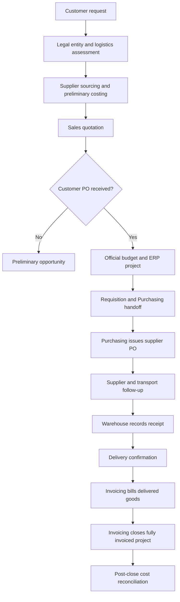

# Operating Model and Process Architecture

## Exceptions
Customer scope change: revised customer PO, versioned budget, same ERP project and new supplier PO for additional purchases.

Supplier price/date change: assess impact, coordinate with Finance and Purchasing for corrections, then verify.

Partial receipts: invoice only goods actually delivered, with customer agreement.

Questionable costs: request correction from entry owner; if unresolved, retain ERP-reported amount with annotation in monthly report.

Historical weekly project tracking used markers for purchases made, material received and invoicing requested. Follow-ups were via email.